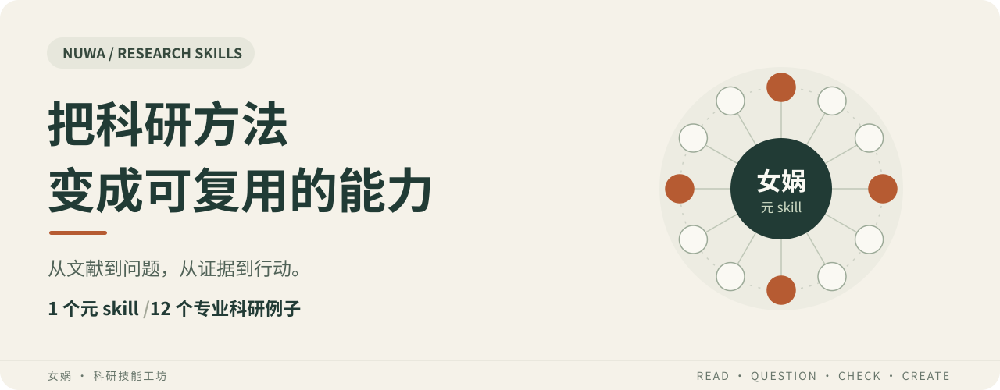

# 女娲 · 科研技能工坊

**让一次科研经验，成为下一次研究的起点。**

女娲把科研需求和方法，整理成 AI 可以调用、研究者可以检查和改进的 skill。本包包含 **1 个女娲元 skill + 12 个专业科研例子**：从找文献、辨析争议，到发现问题、设计研究和组织论证，都有可以开始的地方。

Skill 是一份可复用的任务方法，写清楚何时使用、需要什么材料、怎样操作、交付什么，以及结论能支持到哪里。

[先试一个](#quickstart) · [挑选 12 个例子](#examples) · [用女娲创建能力](#create) · [组合使用](#compose) · [来源与许可](#license)

---

## 你现在卡在哪一步？

| 你手头的困境 | 可以从这里开始 | 希望拿到的产物 |
|---|---|---|
| 读了不少论文，却讲不清它们之间的关系 | 文献串联 | 带原文依据的关系表、发展脉络和未决分歧 |
| 两篇研究结论相反，不知道该相信什么 | 研究交叉评议 | 可比条件、支持与冲突、还缺哪些证据 |
| 有一个研究想法，担心别人已经做过 | 新颖性核查 | 最接近的已有工作、已覆盖内容和剩余差别 |

这些是使用场景与交付目标；实际结论取决于你提供的材料和可用证据。

你可以直接使用专业例子，也可以让女娲把自己的研究方法整理成新的 skill。

## 先试一个：从文献调研开始

**第一次使用，建议只选一个与你眼前任务有关的例子。**

### 1. 让 AI 帮你安装

下载并解压本发行包，将文件夹交给能读写本地文件的 AI 助手，然后复制这段话：

~~~text
请从我提供的 nuwa-research-skills 文件夹中，
将 examples/literature-review 完整安装到当前项目的
.agents/skills/literature-review/。

请保留 references、agents 和 LICENSE。
如果已有同名技能，先比较内容并保留原版本备份。
完成后告诉我怎样调用。
~~~

这里给出的是 Codex 的项目目录示例。其他支持本地 skills 的工具，使用各自的技能目录和调用方式；本包没有对所有工具逐一测试。

手动安装，以及安装女娲和其他例子

将需要的**完整目录**复制到当前项目的 `.agents/skills/` 下，保持技能名称与目录名一致：

| 想用的能力 | 从发行包中复制 | 复制到当前项目 |
|---|---|---|
| 创建和改进科研 skill | `huashu-nuwa/` | `.agents/skills/huashu-nuwa/` |
| 文献调研 | `examples/literature-review/` | `.agents/skills/literature-review/` |
| 其他专业例子 | `examples/对应技能名/` | `.agents/skills/对应技能名/` |

安装后，例如：

~~~text
你的项目/
└── .agents/
    └── skills/
        ├── huashu-nuwa/
        │   ├── SKILL.md
        │   ├── README.md
        │   ├── LICENSE
        │   └── references/
        └── literature-review/
            ├── SKILL.md
            ├── LICENSE
            ├── agents/
            └── references/
~~~

本发行包的根目录是资料与技能的集合；安装单位是上表中的各个技能目录。只复制一个 `SKILL.md` 会遗漏它引用的方法文件。保留已有同名技能的备份时，请放在技能扫描目录之外。

Codex 的本地发现与调用方式见 [OpenAI 官方技能文档](https://learn.chatgpt.com/docs/build-skills)：项目技能位于 `.agents/skills/`；CLI 或 IDE 扩展可用 `$` 选择技能，匹配的任务也可触发自动选择。新技能没有出现时可重启 Codex。

### 2. 提出一个真实的小任务

装好后，附上自己的论文或笔记，再说：

~~~text
请用 literature-review，围绕我提供的研究问题做一轮文献调研。
先使用附带的论文和笔记，再补查关键缺口。
请区分已经读到的原文、摘要线索和你的推断，
交付主要研究脉络、分歧、未解决问题与可追溯来源。
~~~

第一次试用时，重点检查三件事：**关键判断能否回到原文、分歧有没有被保留、缺少的证据有没有说清楚。** 需要调整范围、语言或深度，直接在请求中说明。

## 12 个例子，按你要解决的问题挑选

每个例子都是独立的 skill，包含使用说明、方法参考和界面元数据，可以单独安装。它们也是学习如何设计科研 skill 的样本；不需要先安装女娲才能使用。

| 你现在想做什么 | 专业例子 | 主要产物 |
|---|---|---|
| 找到并梳理相关研究 | [文献调研](examples/literature-review/SKILL.md) | 检索记录、证据整理、研究脉络与缺口 |
| 说明论文之间怎样联系 | [文献串联](examples/literature-synthesis/SKILL.md) | 关系表、论证链或引文脉络 |
| 判断不同研究的支持与冲突 | [研究交叉评议](examples/research-cross-review/SKILL.md) | 条件对照、主张级判断与未决分歧 |
| 从现有材料形成选题 | [科研问题发现](examples/research-question-discovery/SKILL.md) | 有依据、可回答的候选问题 |
| 判断贡献与已有工作差在哪 | [新颖性核查](examples/research-novelty-check/SKILL.md) | 近邻工作比较、覆盖判断与检索边界 |
| 理清术语、概念和理论前提 | [概念对齐与理论综合](examples/concept-theory-synthesis/SKILL.md) | 概念映射、解释比较与综合框架 |
| 检查结论是否被证据支持 | [证据与方法审查](examples/research-evidence-audit/SKILL.md) | 主张审查、方法缺口与修正建议 |
| 找反例、区分竞争解释 | [假设与证伪](examples/hypothesis-falsification/SKILL.md) | 竞争假设、反例与区分性检验 |
| 把问题变成研究方案 | [研究设计](examples/research-design/SKILL.md) | 协议、对照、测量与判定条件 |
| 核对已有研究结果 | [复现与结果核验](examples/research-reproduction/SKILL.md) | 执行记录、结果比较与差异定位 |
| 把材料写成清晰的论证 | [学术写作](examples/scholarly-writing/SKILL.md) | 主张与证据对应的正文或修订稿 |
| 决定先投入哪个研究方向 | [研究路线规划](examples/research-roadmapping/SKILL.md) | 条件化优先级、阶段目标与转向条件 |

**[打开例子使用手册 →](examples/README.md)** 每个例子都配有一条起步请求、所需材料和产物检查点。

## 让女娲把你的方法变成 skill

专业例子负责完成相应科研任务。**女娲负责设计、创建、组合和改进这些能力。**

安装 [huashu-nuwa](huashu-nuwa/SKILL.md) 后，可以这样开始：

~~~text
请用女娲，把“研究变量与测量口径核对”做成可复用的科研 skill。
输入包括变量定义、量表说明、数据字典和论文方法部分；
我希望得到口径差异、影响哪些比较、需要补查什么的记录。

先检查现有例子能否复用或改造，再决定是否新建。
默认跨课题使用，保留方法来源、适用前提和失败边界。
完成后给出一个小任务的试用办法，并说明哪些部分还未实测。
~~~

也可以把一次失败交给女娲：

~~~text
这个 skill 把两篇共享同一数据集的论文当成了两份独立证据。
请结合我附上的输入与输出定位原因，修改相关规则，
再检查原任务与相邻场景中是否还会出现同样问题。
~~~

女娲优先复用已有能力；需要组合时明确输入、输出和交接；需要新建时生成最小可用版本。首次使用会简要说明默认范围和可调整项，然后推进。课题、资料范围、检索深度、输出形式和保存位置都可以调整。

## 把几个例子连起来用

从当前缺少的那一步开始，按需要组合：

| 研究目标 | 一种可用的组合 | 需要带到下一步的内容 |
|---|---|---|
| 从一批论文中找到选题 | 文献调研 → 文献串联或交叉评议 → 问题发现 → 新颖性核查 | 原始依据、真正的分歧、候选问题与已覆盖内容 |
| 从一个解释走向可检验方案 | 假设与证伪 → 研究设计 | 竞争解释、差异预期、测量与判定条件 |
| 把已有结果整理成可靠表述 | 复现与结果核验 → 证据审查 → 学术写作 | 实际产物、核验结果、结论范围与未决问题 |

方案制定、首次执行和复核已有结果是不同的工作。需要真实实验或计算时，另行明确执行步骤、材料与资源；已有执行授权时继续推进。方案、结果或目标改变后，更新受到影响的下游判断。组合细节见 [交接与回路](huashu-nuwa/references/composition-handoff.md)。

## 一份方法，怎样成为可复用能力？

每份 skill 尝试把研究方法落到五件可检查的事上：

**何时使用 → 读什么材料 → 做哪些操作 → 交付什么 → 何时收窄或停止。**

女娲的参考文档解释了这一过程：

- [能力方向](huashu-nuwa/references/capability-map.md)：怎样拆解需求、复用和组合能力。
- [来源与数据](huashu-nuwa/references/sources-and-data.md)：构建 skill 与运行 skill 分别需要什么资料。
- [提炼与检验](huashu-nuwa/references/extraction-framework.md)：怎样保留方法依据、迁移前提和失效边界。
- [专业 skill 模板](huashu-nuwa/references/skill-template.md)：怎样把设计写成可执行的技能文件。

例子中的 `references/methods.md` 进一步区分原始方法、工作流改编和验证状态。研究中的临时结论留在任务材料中，有复用价值的方法才进入 skill。

## 怎样理解它的能力与边界？

本包提供科研方法与操作指引。使用效果取决于模型、工具、材料质量和实际任务。

当前发行整理检查了 **13 个技能的文件结构、元数据、包内相对链接和复制完整性**。例子的方法文件保留了创建阶段的场景走查及有限试用说明；本包未附带这些历史试用的全部原始输入、执行日志和产物，也没有在本次打包中重跑科研评测。

你可以检查规则和方法依据，再用自己的小任务验证。已有说明不构成跨学科效果、效率提升、论文发表或创新性的保证。未检索到不能证明从未有人研究过，提出方案不能视为已执行，多个 skill 的输出也不能累加成独立证据。

## 开始前可能还想知道

**必须一次安装全部吗？**  
按任务选择即可。专业例子可以独立使用；需要创建和改进能力时再使用女娲。

**必须购买插件或接入特定文献库吗？**  
本包是指令、参考文档和展示素材，没有安装脚本，也没有指定必装的检索插件。联网检索、文献库、代码运行和文件写入由你的工具环境提供；只用本地材料时，结论限于可访问材料。

**适用于什么学科？**  
设计目标是跨课题复用。具体任务仍需选择合适的证据与方法：理论推导、实验、观察研究和质性材料各有不同要求，跨学科效果需要分别检验。

**不会配置本地 skills，可以先看吗？**  
可以从例子的 `SKILL.md` 开始，把它和任务所需的参考文件交给 AI 阅读，作为方法指南使用。能否自动发现技能、读写文件或联网，取决于所在工具。

**怎样反馈最有帮助？**  
提供可公开的任务输入、实际输出、哪里判断错了，以及可以核对的原始依据。可复查的失败案例，有助于明确应改哪条规则。

## 发行包里有什么

~~~text
nuwa-research-skills/
├── README.md                    # 从这里开始
├── LICENSE
├── assets/
│   └── hero.svg                 # README 封面
├── huashu-nuwa/                 # 女娲元 skill，可独立安装
│   ├── SKILL.md
│   ├── README.md
│   ├── LICENSE
│   └── references/              # 5 份设计与方法参考
├── examples/                    # 12 个完整专业 skill
│   ├── README.md                # 逐例起步请求与检查点
│   ├── literature-review/
│   ├── literature-synthesis/
│   ├── research-cross-review/
│   ├── research-question-discovery/
│   ├── research-novelty-check/
│   ├── concept-theory-synthesis/
│   ├── research-evidence-audit/
│   ├── hypothesis-falsification/
│   ├── research-design/
│   ├── research-reproduction/
│   ├── scholarly-writing/
│   └── research-roadmapping/
└── docs/
    └── communication-design.md  # 面向维护者的传播设计与介绍文案
~~~

每个专业例子含 `SKILL.md`、`references/`、`agents/openai.yaml` 和 `LICENSE`。发行包不包含本地备份、私人研究材料、账户配置或历史评估工作目录。

## 来源与许可

女娲元 skill 基于 **Huashu（花叔）** 的 [nuwa-skill](https://github.com/alchaincyf/nuwa-skill) 改编，技能标识保留为 `huashu-nuwa`，当前元 skill 元数据版本为 **3.1.2**。本包将其整理为面向科研能力构建的独立改编版，并加入 12 个专业科研例子。

上游项目也为本 README 的场景展示和低门槛入口提供了编排参考。作者署名和上游链接用于说明来源；本包不代表上游的官方发行或维护承诺。

采用 [MIT 许可](LICENSE)，保留上游版权与许可文本。每个可独立复制的技能目录均附有许可文件。参考文档中的外部链接用于定位来源，外部论文、网页和数据并未随包重新分发。

维护者可参阅 [传播设计与介绍文案](docs/communication-design.md)。

---

**从一个真实研究问题开始，把有用的方法留下来。**

[选择一个专业例子](examples/README.md) · [打开女娲元 skill](huashu-nuwa/SKILL.md)
